# V7 Player

**V7 Player — Media & streaming for jailbroken PS4**

  
  
  

  <strong>Xtream Codes · M3U / M3U8 · Stalker / MAG · Jellyfin / Emby · Stremio add-ons · Live TV · Movies · Series · Local Media · Offline Downloads</strong>

  <a href="../../releases/latest"><strong>Download Latest Release</strong></a>
  · <a href="../../issues">Report a Bug</a>
  · <a href="#building-from-source">Build from Source</a>

> **V7 Player is a player only.** It provides no channels, subscriptions, movies, series, servers, add-ons,
> playlists, accounts or copyrighted content, and it is not affiliated with any provider. You add your own lawful
> sources and are responsible for having permission to access, play and download their content.

  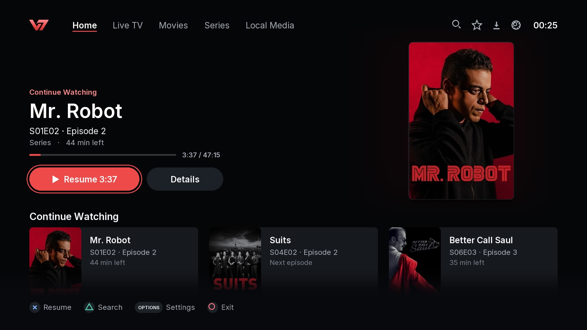

V7 Player is the new name of V7 IPTV (and PS4 IPTV before it). The package keeps its Title ID (`IPTV00002`), its
content ID and its data folder (`/data/PS4IPTV/`), so it installs over earlier versions as an update and keeps your
sources, settings, history, playlists and downloads.

## What's new in v0.5.0

- **V7 Player**: new name, icon and start image, and a loading screen in your chosen accent colour
- **Live TV in the player**: ← opens the channel list, ← again the groups, → the programme guide; switch channels
  without leaving the player
- **Programme guide (EPG)**: Xtream and Stalker short EPG, XMLTV guides named by M3U playlists (`url-tvg`), gzip
  included
- **My Playlists**: your own playlists, shown as groups in Live TV, with ordering and visibility
- **Jellyfin / Emby** servers: sign in, browse Movies and Series, play, resume
- **Stremio add-ons** (basic): catalogs and details, playback of direct HTTP(S) streams
- **USB drives in Local Media**: fixed drives not being listed in v0.4.0 (`/usb0` … `/usb7`)
- **Hardening**: a startup crash guard and diagnostics, damaged data files kept and recovered instead of lost, no
  credentials or local file names in the log, many network failure cases handled
- **Compatibility and stability** improvements throughout

See the [v0.5.0 release notes](docs/releases/v0.5.0.md) for details and the
[compatibility matrix](docs/v7-player-compatibility.md).

## Highlights

- **Xtream Codes**, **M3U / M3U8**, **Stalker / MAG** (experimental), **Jellyfin / Emby** and **Stremio add-ons**
  (basic) as sources
- **Live TV, Movies and Series** with categories, search, sorting and favorites
- **Live TV in the player**: channel list, groups and programme guide; **XMLTV** and short EPG
- **My Playlists**: your own playlists as Live TV groups
- **Continue Watching** and **Recently Watched** with exact resume positions
- **Next Episode** card with Play now / Watch credits and season-to-season playback
- **Offline downloads** for movies and episodes with resumable transfers
- **Local Media** player for files on the console and USB drives
- **HTTP and HTTPS** streams, HLS included
- **Multiple audio tracks and embedded subtitles**
- **Aspect Ratio, Crop / Fill, Zoom and video position** controls
- **Nine accent themes** on a neutral black / charcoal interface, also used by the loading screen
- **English and Turkish UI**
- **DualShock 4 optimized navigation** with accelerated hold-to-scroll, plus keyboard support

## Screenshots

<table>
  <tr>
    <td width="50%">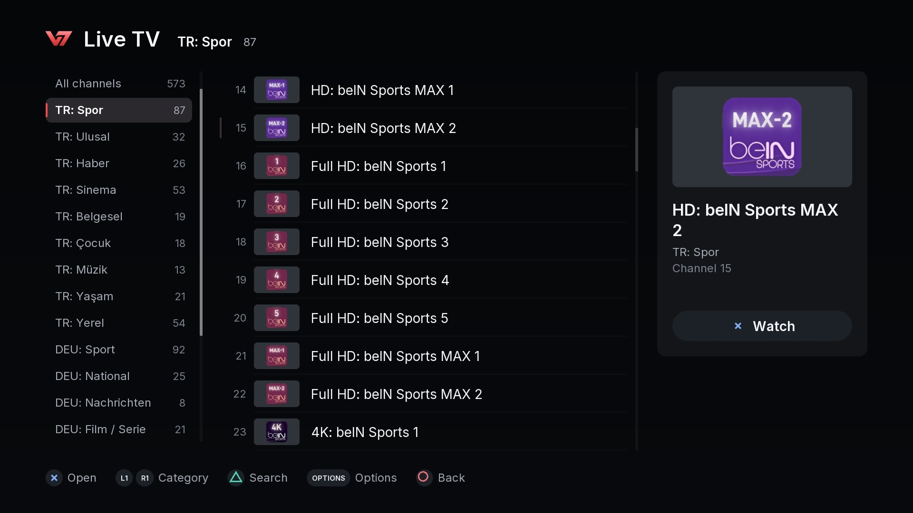</td>
    <td width="50%">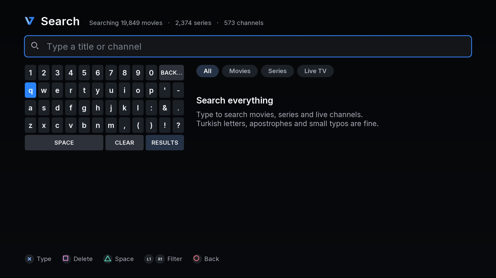</td>
  </tr>
  <tr>
    <td align="center">Live TV</td>
    <td align="center">Search</td>
  </tr>
  <tr>
    <td>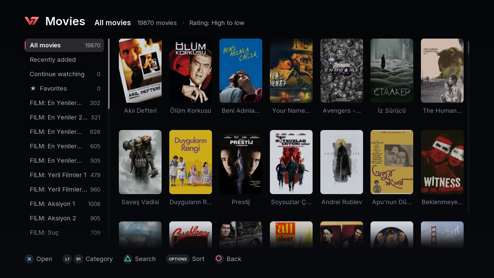</td>
    <td>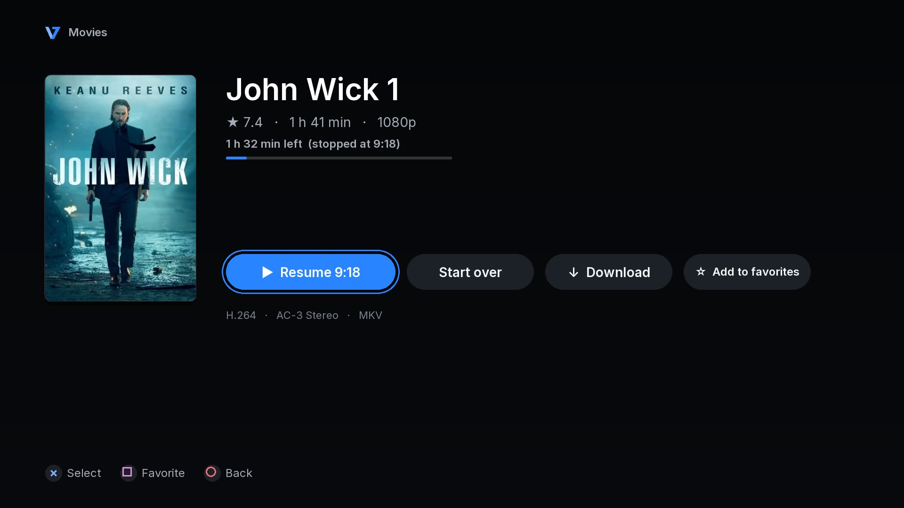</td>
  </tr>
  <tr>
    <td align="center">Movies</td>
    <td align="center">Movie details</td>
  </tr>
  <tr>
    <td>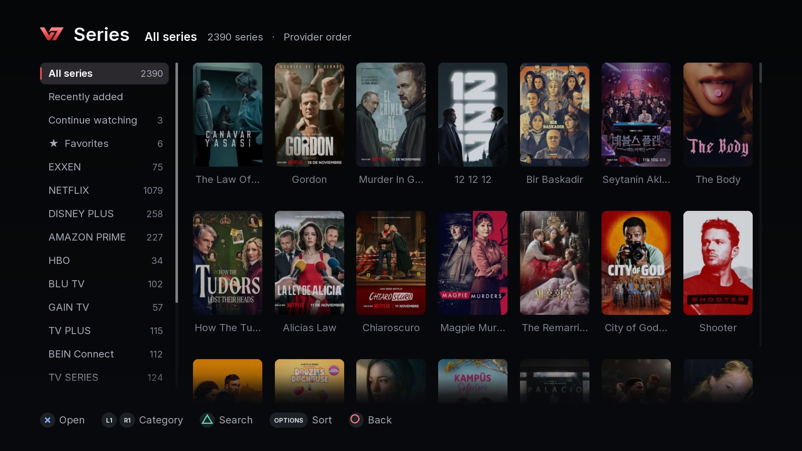</td>
    <td>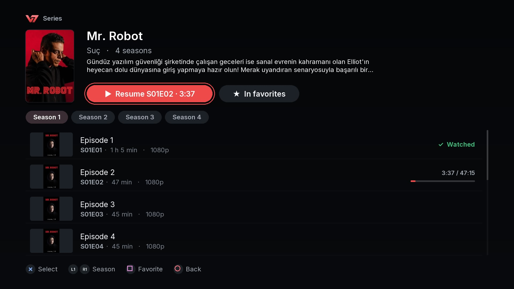</td>
  </tr>
  <tr>
    <td align="center">Series</td>
    <td align="center">Series details</td>
  </tr>
  <tr>
    <td>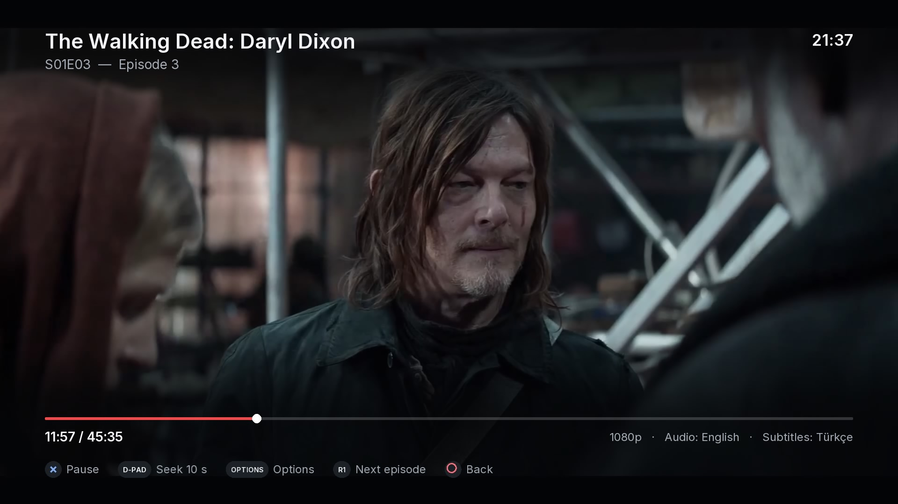</td>
    <td>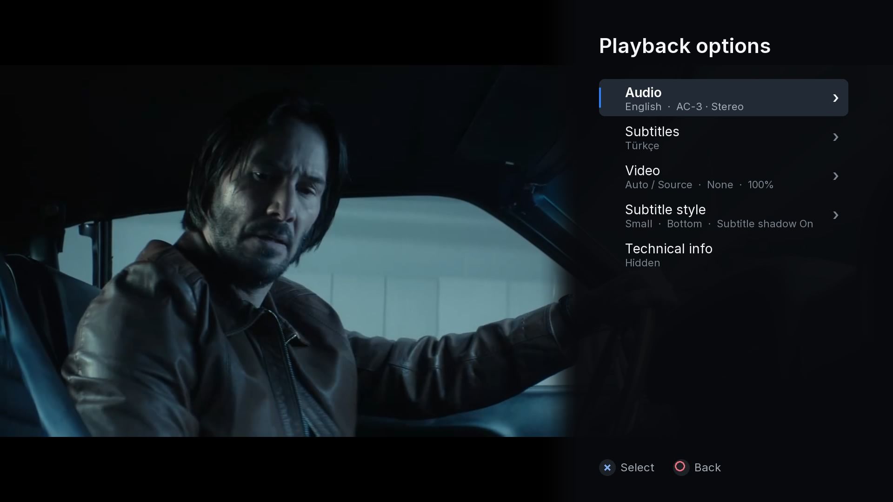</td>
  </tr>
  <tr>
    <td align="center">Playback</td>
    <td align="center">Playback options</td>
  </tr>
  <tr>
    <td>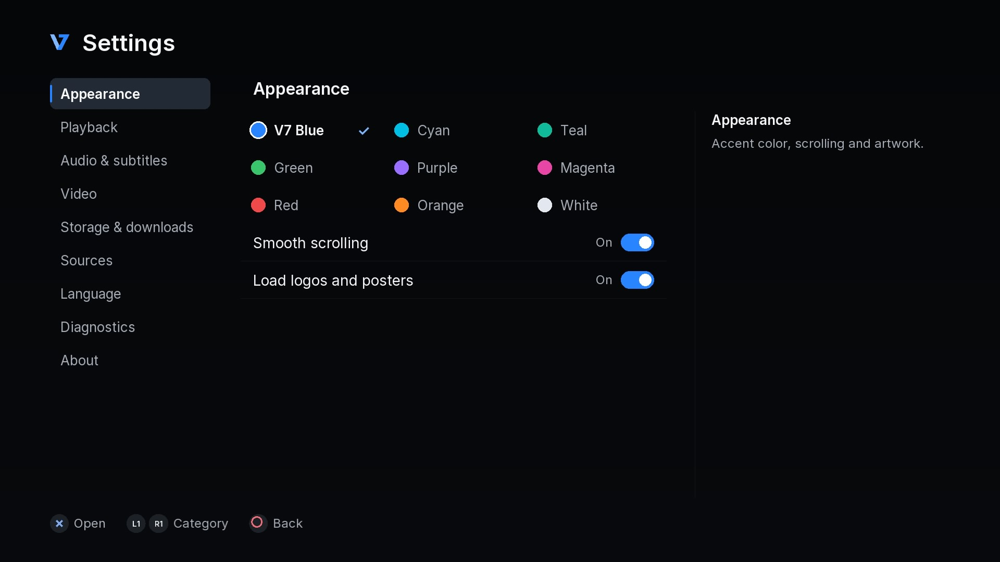</td>
    <td>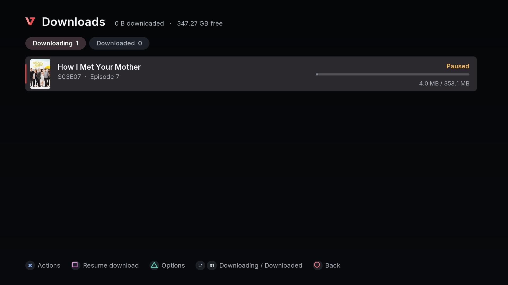</td>
  </tr>
  <tr>
    <td align="center">Settings</td>
    <td align="center">Downloads</td>
  </tr>
</table>

Screenshots were captured on a real PS4. Channel names, logos, posters, artwork, video frames and media
metadata shown in them come from the user's configured source, belong to their respective owners and are not
distributed with V7 Player.

## Features

### Sources

| | Xtream Codes | M3U / M3U8 | Stalker / MAG (experimental) | Jellyfin / Emby | Stremio add-on (basic) |
|---|---|---|---|---|---|
| Live TV | ✓ | ✓ | ✓ | – | – |
| Programme guide | short EPG | XMLTV (`url-tvg`) | short EPG | – | – |
| Movies / Series | ✓ | – | ✓ (when the portal offers them) | ✓ | ✓ (direct HTTP(S) streams) |
| Offline downloads | ✓ | – | – | – | – |

Multiple sources can be added. M3U / M3U8 entries are always treated as live channels. **Local Media** works without
any source. *Live TV › OPTIONS › My Playlists* keeps your own playlists; they appear as groups in Live TV.

### Jellyfin / Emby and Stremio

*Add Source › Jellyfin / Emby* takes the server address (with its port), user name and password. Files play as they
are (direct play, no server transcoding); resume positions and progress are shared with the server.

*Add Source › Stremio* takes the address of an add-on's `manifest.json`. One add-on per source; only streams with a
direct HTTP(S) address can be played; torrent, YouTube and external-link streams are not supported. V7 Player does
not include or recommend any add-on.

### Playback

- HTTP and HTTPS streams (MPEG-TS, HLS and other formats FFmpeg opens); HTTPS certificates are always verified
- Exact resume positions, Continue Watching and Recently Watched
- Multiple embedded audio and subtitle tracks, with subtitle size, position and shadow
- Arabic, Persian and Hebrew subtitles through the bundled subtitle font
- Aspect Ratio, Crop / Fill, Zoom and video position
- Next Episode card with automatic season-to-season playback

### Stalker / MAG portals (experimental)

*Add Source › Stalker / MAG Portal* takes a name, the portal address and the MAC address registered with your
provider. V7 Player signs in like a MAG box, loads Live TV, Movies and Series, and asks the portal for a fresh stream
address for every playback. Portal implementations differ between providers, so compatibility is not guaranteed.
Portals that require a login and password for the box and catch-up are not supported, and portal sources cannot be
downloaded. The MAC address, tokens and device identifiers are never written to the log.

### Local Media

*Local Media* (Home navigation, the first screen and Sources) lists internal storage (`/data`) and USB drives
formatted exFAT or FAT32 (the app sees them as `/usb0` … `/usb7`; over FTP they are `/mnt/usb0` …). Folders come first, then the video
and audio files the player can open (MKV, MP4, TS / M2TS, AVI, MOV, WebM, MP3, FLAC…). Files play with the same audio,
subtitle and video options as movies; they are not added to history, Continue Watching, favorites or search.

### Downloads

Movies and series episodes from Xtream sources can be downloaded for offline playback. Interrupted downloads can
resume, and playback progress is shared with the streamed version.

### Appearance

*Settings › Appearance* includes **V7 Blue, Cyan, Teal, Green, Purple, Magenta, Red, Orange and White** accents. The
base interface remains neutral black / charcoal.

## Quick Start

1. Download the latest PKG from [Releases](../../releases/latest).
2. Install it with your PS4 homebrew package installer. It installs over earlier versions as an update and keeps your
   sources, settings, favorites, history and downloads.
3. Launch **V7 Player**.
4. Choose **Add Source** (or **Local Media** to play files on the console).
5. Add your own Xtream Codes account, M3U / M3U8 playlist, Stalker / MAG portal, Jellyfin / Emby server or Stremio
   add-on.

The application stores its data in `/data/PS4IPTV/`. Source details stay on the console.

## Controls

| Button | Action |
|---|---|
| ✕ | Select / open / play; pause / resume in the player; Play now on the Next Episode card |
| ○ | Back; Watch credits on the Next Episode card |
| □ | Favorite; download an episode; remove a Continue Watching or Recently Watched item |
| △ | Search; technical info during playback |
| OPTIONS | Context menu / settings / playback options |
| L1 / R1 | Previous / next category, season or tab; on Home: previous / next navigation item |
| L2 / R2 | Page up / down; seek 1 minute during playback |
| D-pad ← → | Seek 10 seconds during playback; in the Live TV player: ← channel list (again: groups), → programme guide |
| D-pad ↑ ↓ | In the Live TV player: previous / next channel |

Hold a direction to move quickly through long lists. Option lists change their value only with ✕.

**Keyboard** (USB or Bluetooth, US or Turkish Q layout, *Settings › Language › Keyboard layout*): type into search
and every text field; arrows = D-pad, Enter = ✕, Esc / Backspace = ○, Tab / Shift+Tab = R1 / L1, Page Up / Down =
L2 / R2. On-screen hints follow the device you used last.

## Next Episode

When another series episode is available, a small card appears **45 seconds** before the end (adjustable in
*Settings › Playback › Show the Next Episode card*: 15, 30, 45, 60 or 90 seconds):

- **✕ Play now** starts the next episode immediately.
- **○ Watch credits** keeps watching without automatic playback.
- With *Auto-play next episode* on (the default), the next episode starts after a 7-second countdown. With it off,
  the card offers the next episode without starting it.

The card also appears when a file ends earlier than its reported length. It works from Series details and Continue
Watching and follows the provider's episode order across seasons. In offline mode the next episode must already be
downloaded. Continue Watching moves a series on to its next episode once the last 45 seconds are reached.

## Compatibility

| | |
|---|---|
| **Hardware-tested** | system software **13.02** (GoldHEN), the developer's console |
| **Known issue** | **13.52**: a startup crash was reported for v0.4.0 and is still under investigation. Logs from an affected console help: `/data/PS4IPTV/logs/` |
| **Unverified** | every other firmware version |

Jellyfin / Emby and Stremio support were tested against local mock servers, not against real servers or add-ons on
a console. The full matrix (hardware-tested, host-tested, unverified, known issues) is in
[docs/v7-player-compatibility.md](docs/v7-player-compatibility.md).

## Known limitations

- **Jellyfin / Emby and Stremio** have not been verified with real servers and add-ons on PS4 hardware.
- **Stremio**: direct HTTP(S) streams only; torrent and YouTube streams are not supported.
- **YouTube page addresses** (in M3U playlists) cannot be played.
- **Discs**: commercial encrypted Blu-ray (AACS / BD+) is not supported; data-disc playback is not verified on
  hardware (the console may not make discs available to applications).
- **HTTPS streams** use TLS 1.2 (Mbed TLS): servers that only accept TLS 1.3 cannot be played, and streams with an
  untrusted or expired certificate are refused.
- **Stalker / MAG support is experimental** and provider-dependent (see above).
- **M3U / M3U8 sources are Live TV only.**
- No recording, catch-up or timeshift.
- Video is decoded in software; very high bitrates or 4K may not play smoothly.
- Thai, Indic scripts, emoji and some CJK characters show boxes, in the interface and in subtitles. Arabic and Hebrew
  use basic right-to-left reordering, not full shaping.

## Building from source

Build and verification scripts are included in `scripts/`, with PS4 toolchain files in `cmake/`. The repository
contains both Bash and PowerShell workflows for contributors.

## License

V7 Player is free software under the **GNU General Public License v3.0 or later**. See [LICENSE](LICENSE) and
[NOTICE](NOTICE) for license and third-party attribution details.

See [CONTRIBUTING.md](CONTRIBUTING.md) for contributions and [SECURITY.md](SECURITY.md) for security reports.

PlayStation and DualShock are trademarks of Sony Interactive Entertainment Inc. This project is not affiliated with or
endorsed by Sony.
