# V7 IPTV

Native, open-source IPTV and media client for jailbroken PlayStation 4 consoles, designed for TV and DualShock 4.

  
  
  

  <strong>Xtream Codes · M3U / M3U8 · Live TV · Movies · Series · Offline Downloads</strong>

  <a href="../../releases/latest"><strong>Download Latest Release</strong></a>
  · <a href="../../issues">Report a Bug</a>
  · <a href="#building-from-source">Build from Source</a>

> **V7 IPTV is a client only.** It includes no channels, movies, series, accounts, subscriptions or playlists. Use your own legitimate source.

  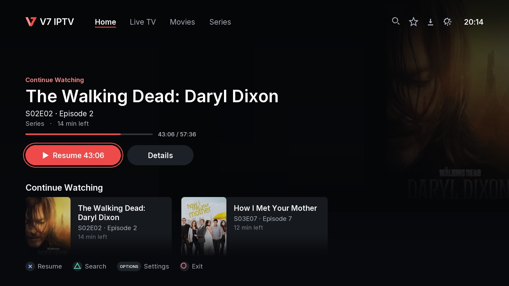

## Highlights

- **Xtream Codes** and **M3U / M3U8** sources
- **Live TV, Movies and Series** with categories, search, sorting and favorites
- **Continue Watching** and **Recently Watched** with exact resume positions
- **45-second Next Episode** countdown with Play now / Cancel and season-to-season playback
- **Offline downloads** for movies and episodes with resumable transfers
- **Multiple audio tracks and embedded subtitles**
- **Aspect Ratio, Crop / Fill, Zoom and video position** controls
- **Nine accent themes** on a neutral black / charcoal interface
- **English and Turkish UI**
- **DualShock 4 optimized navigation** with accelerated hold-to-scroll

## Screenshots

<table>
  <tr>
    <td width="50%">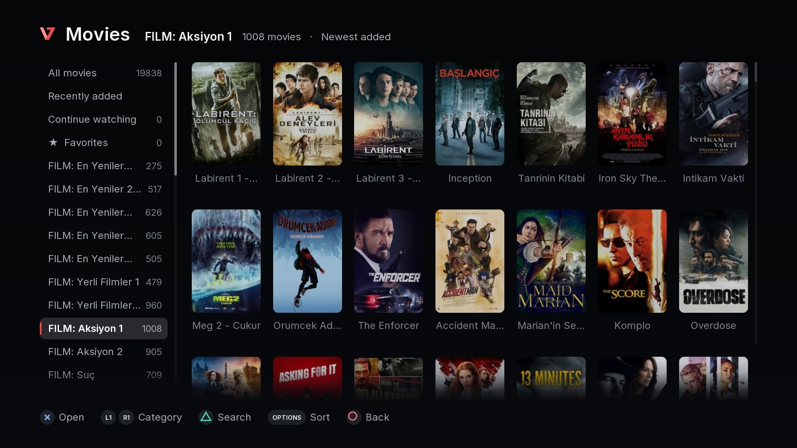</td>
    <td width="50%">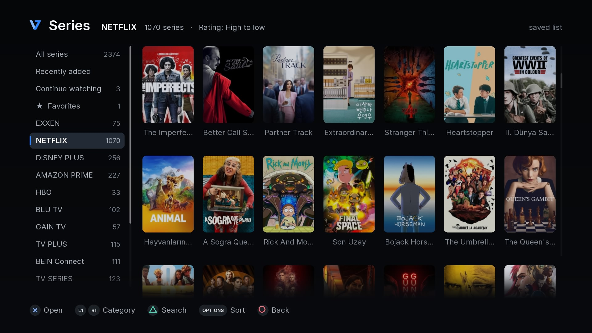</td>
  </tr>
  <tr>
    <td align="center">Movies</td>
    <td align="center">Series</td>
  </tr>
  <tr>
    <td>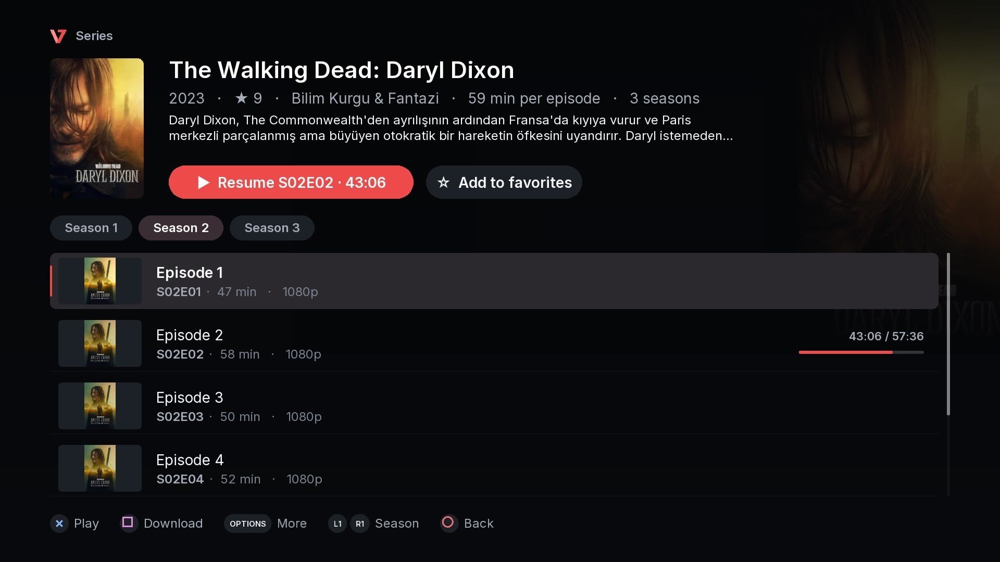</td>
    <td>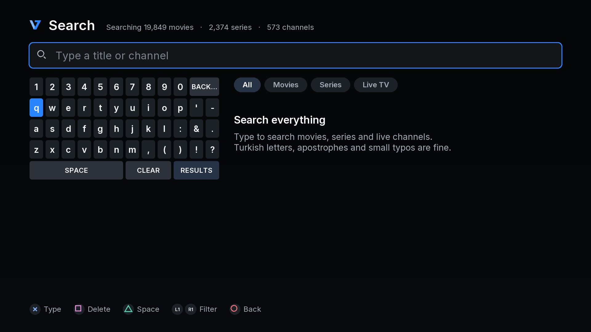</td>
  </tr>
  <tr>
    <td align="center">Series details</td>
    <td align="center">Search</td>
  </tr>
  <tr>
    <td>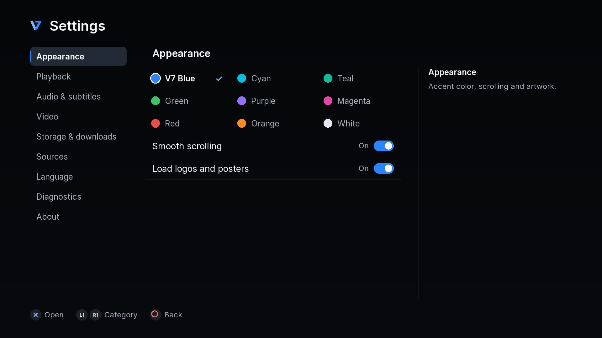</td>
    <td>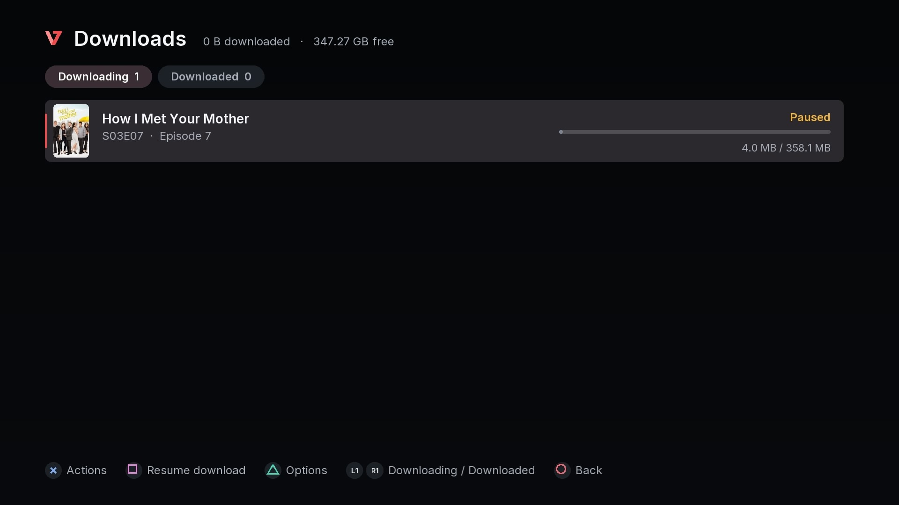</td>
  </tr>
  <tr>
    <td align="center">Settings</td>
    <td align="center">Downloads</td>
  </tr>
  <tr>
    <td>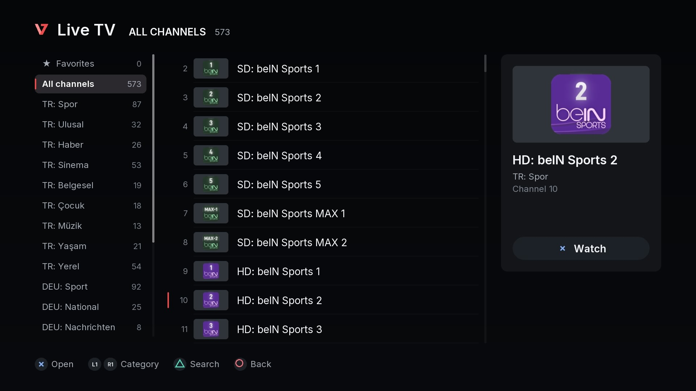</td>
    <td>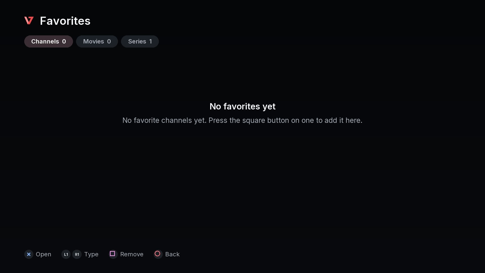</td>
  </tr>
  <tr>
    <td align="center">Live TV</td>
    <td align="center">Favorites</td>
  </tr>
  <tr>
    <td>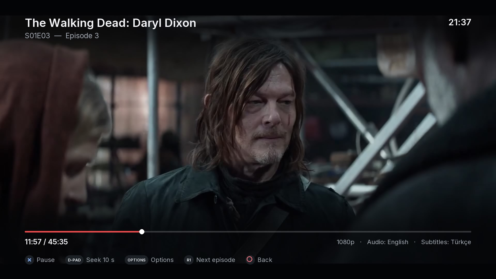</td>
    <td>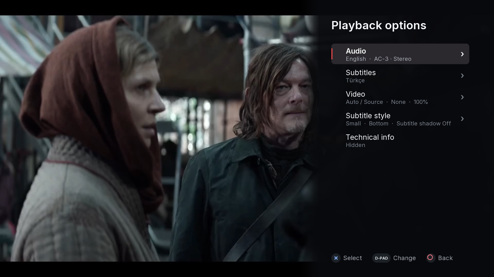</td>
  </tr>
  <tr>
    <td align="center">Playback</td>
    <td align="center">Playback options</td>
  </tr>
</table>

Screenshots were captured on a real PS4. Posters, logos, artwork and media metadata shown in them come from the user's configured source and are not distributed with V7 IPTV.

## Features

### Sources and browsing

- Multiple **Xtream Codes** sources
- **M3U / M3U8** playlists for Live TV
- Categories, sorting and tolerant search
- Favorites for channels, movies and series
- Channel logos, movie/series posters and metadata

### Playback

- Exact resume positions
- Continue Watching and Recently Watched
- Multiple embedded audio and subtitle tracks
- Subtitle size, position and shadow controls
- Aspect Ratio, Crop / Fill, Zoom and video position
- 45-second Next Episode countdown for series
- Automatic next-season transition when another episode is available

### Downloads

Movies and series episodes from Xtream sources can be downloaded for offline playback. Interrupted downloads can resume, and playback progress is shared with the streamed version.

### Appearance

*Settings › Appearance* includes **V7 Blue, Cyan, Teal, Green, Purple, Magenta, Red, Orange and White** accents. The base interface remains neutral black / charcoal.

### Source support

| | Xtream Codes | M3U / M3U8 |
|---|---|---|
| Live TV | ✓ | ✓ |
| Movies / Series | ✓ | – |
| Search / Favorites | ✓ | ✓ |
| Continue Watching | ✓ | – |
| Offline downloads | ✓ | – |

## Quick Start

1. Download the latest PKG from [Releases](../../releases/latest).
2. Install it with your PS4 homebrew package installer.
3. Launch **V7 IPTV**.
4. Choose **Add Source**.
5. Add your Xtream Codes account or M3U / M3U8 playlist.

The application stores its data in `/data/PS4IPTV/`.

## Controls

| Button | Action |
|---|---|
| ✕ | Select / open / play; pause / resume in the player; Play now during Next Episode |
| ○ | Back; Cancel during Next Episode |
| □ | Favorite; download an episode; remove a Continue Watching item |
| △ | Search; technical info during playback |
| OPTIONS | Context menu / settings / playback options |
| L1 / R1 | Previous / next category, season, tab or episode |
| L2 / R2 | Page up / down; seek 1 minute during playback |
| D-pad ← → | Seek 10 seconds during playback |

Hold a direction to move quickly through long lists.

## Next Episode

When another series episode is available, a panel appears during the final **45 seconds**:

- **✕ Play now** starts the next episode immediately.
- **○ Cancel** disables auto-play for the current playback.
- If no button is pressed, the next episode starts when the current episode ends.

The feature works from Series Detail and Continue Watching, follows the provider's episode order across seasons, and only advances offline when the next episode is already downloaded. It can be disabled in *Settings › Playback*.

## Known limitations

- **HTTPS media streams are not supported** by the bundled playback stack. API requests, images, playlist downloads and offline downloads can still use HTTPS.
- **M3U / M3U8 sources are Live TV only.**
- No EPG, recording or timeshift.
- Video is decoded in software; very high bitrates or 4K may not play smoothly.
- Some writing systems and subtitle scripts are not fully supported.

## Building from source

Build and verification scripts are included in `scripts/`, with PS4 toolchain files in `cmake/`. The repository contains both Bash and PowerShell workflows for contributors.

## License

V7 IPTV is free software under the **GNU General Public License v3.0 or later**. See [LICENSE](LICENSE) and [NOTICE](NOTICE) for license and third-party attribution details.

See [CONTRIBUTING.md](CONTRIBUTING.md) for contributions and [SECURITY.md](SECURITY.md) for security reports.

PlayStation and DualShock are trademarks of Sony Interactive Entertainment Inc. This project is not affiliated with or endorsed by Sony.
