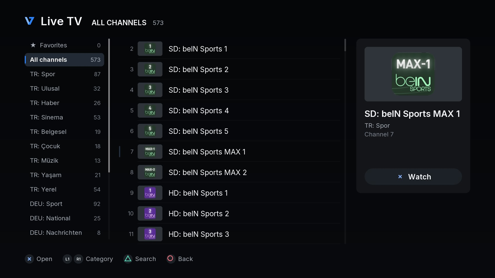
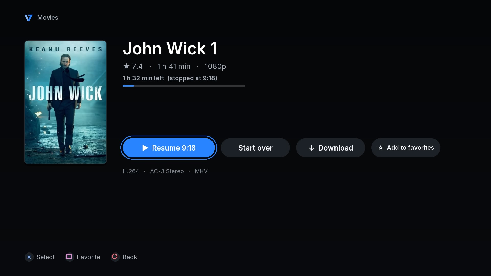
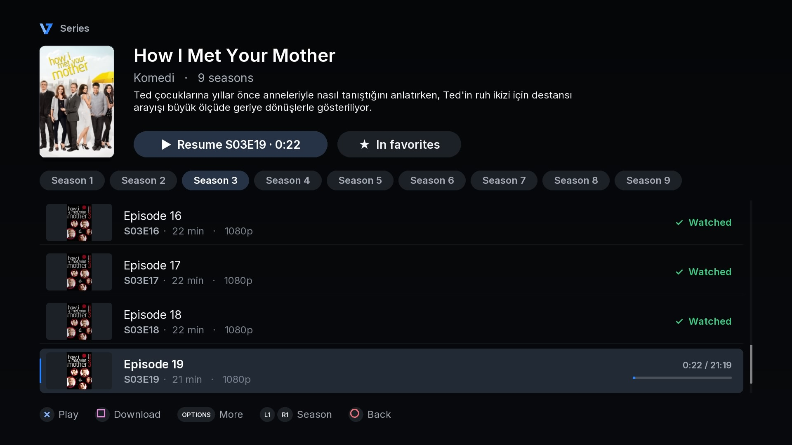
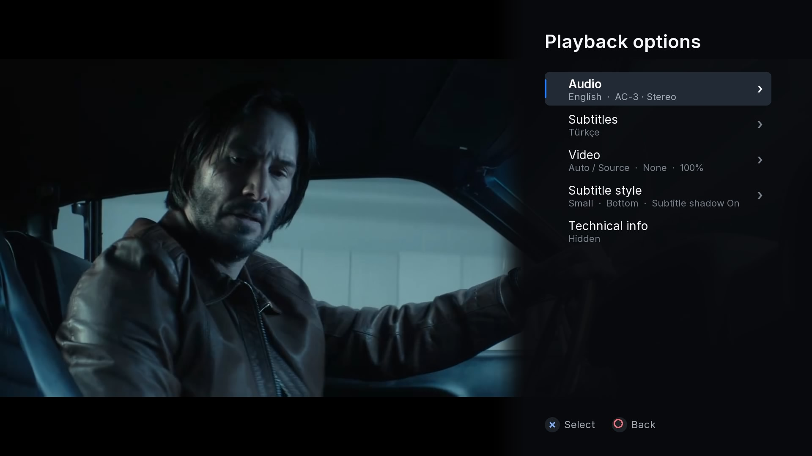
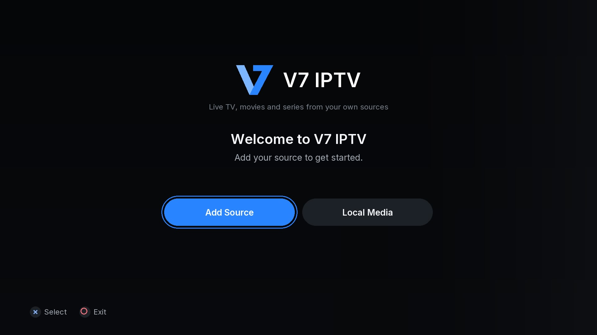

# V7 IPTV

A modern IPTV & media player for jailbroken PS4.

  
  
  

  <strong>Xtream Codes · M3U / M3U8 · Stalker / MAG · Live TV · Movies · Series · Local Media · Offline Downloads</strong>

  <a href="../../releases/latest"><strong>Download Latest Release</strong></a>
  · <a href="../../issues">Report a Bug</a>
  · <a href="#building-from-source">Build from Source</a>

> **V7 IPTV is a player only.** It provides no channels, movies, series, subscriptions, accounts, playlists,
> credentials or copyrighted content, and it is not affiliated with any IPTV provider. You provide your own lawful
> sources and are responsible for having permission to access, play and download their content.

  

## What's new in v0.4.0

- **HTTPS streams**, including HTTPS HLS, with certificate verification
- **Stalker / MAG portal** sources (experimental)
- **Local Media**: play video and audio files from internal storage and USB drives
- **USB / Bluetooth keyboard** support with US and Turkish Q layouts
- **Refined Next Episode card**: appears before the end (adjustable), 7-second countdown, *Play now* / *Watch credits*
- **Cleaner Home and details pages**: sharp framed posters, Continue Watching that follows series to the next episode,
  removable Recently Watched items, L1 / R1 across the top navigation
- **Arabic, Persian and Hebrew subtitles**: a dedicated subtitle font addressing the Arabic subtitle lag reported in
  [#1](../../issues/1), plus network reliability, privacy and security hardening

See the [v0.4.0 release notes](docs/releases/v0.4.0.md) for details.

## Highlights

- **Xtream Codes**, **M3U / M3U8** and **Stalker / MAG** (experimental) sources
- **Live TV, Movies and Series** with categories, search, sorting and favorites
- **Continue Watching** and **Recently Watched** with exact resume positions
- **Next Episode** card with Play now / Watch credits and season-to-season playback
- **Offline downloads** for movies and episodes with resumable transfers
- **Local Media** player for files on the console and USB drives
- **HTTP and HTTPS** streams, HLS included
- **Multiple audio tracks and embedded subtitles**
- **Aspect Ratio, Crop / Fill, Zoom and video position** controls
- **Nine accent themes** on a neutral black / charcoal interface
- **English and Turkish UI**
- **DualShock 4 optimized navigation** with accelerated hold-to-scroll, plus keyboard support

## Screenshots

<table>
  <tr>
    <td width="50%"></td>
    <td width="50%"></td>
  </tr>
  <tr>
    <td align="center">Live TV</td>
    <td align="center">Search</td>
  </tr>
  <tr>
    <td></td>
    <td></td>
  </tr>
  <tr>
    <td align="center">Movies</td>
    <td align="center">Movie details</td>
  </tr>
  <tr>
    <td></td>
    <td></td>
  </tr>
  <tr>
    <td align="center">Series</td>
    <td align="center">Series details</td>
  </tr>
  <tr>
    <td></td>
    <td></td>
  </tr>
  <tr>
    <td align="center">Playback</td>
    <td align="center">Playback options</td>
  </tr>
  <tr>
    <td></td>
    <td></td>
  </tr>
  <tr>
    <td align="center">Settings</td>
    <td align="center">Downloads</td>
  </tr>
</table>

Screenshots were captured on a real PS4. Channel names, logos, posters, artwork, video frames and media
metadata shown in them come from the user's configured source, belong to their respective owners and are not
distributed with V7 IPTV.

## Features

### Sources

| | Xtream Codes | M3U / M3U8 | Stalker / MAG (experimental) |
|---|---|---|---|
| Live TV | ✓ | ✓ | ✓ |
| Movies / Series | ✓ | – | ✓ (when the portal offers them) |
| Search / Favorites / Recently Watched | ✓ | ✓ | ✓ |
| Continue Watching | ✓ | – | ✓ |
| Offline downloads | ✓ | – | – |

Multiple sources can be added. M3U / M3U8 entries are always treated as live channels. **Local Media** works without
any source.

### Playback

- HTTP and HTTPS streams (MPEG-TS, HLS and other formats FFmpeg opens); HTTPS certificates are always verified
- Exact resume positions, Continue Watching and Recently Watched
- Multiple embedded audio and subtitle tracks, with subtitle size, position and shadow
- Arabic, Persian and Hebrew subtitles through the bundled subtitle font
- Aspect Ratio, Crop / Fill, Zoom and video position
- Next Episode card with automatic season-to-season playback

### Stalker / MAG portals (experimental)

*Add Source › Stalker / MAG Portal* takes a name, the portal address and the MAC address registered with your
provider. V7 IPTV signs in like a MAG box, loads Live TV, Movies and Series, and asks the portal for a fresh stream
address for every playback. Portal implementations differ between providers, so compatibility is not guaranteed.
Portals that require a login and password for the box, EPG and catch-up are not supported, and portal sources cannot
be downloaded. The MAC address, tokens and device identifiers are never written to the log.

### Local Media

*Local Media* (Home navigation, the first screen and Sources) lists internal storage (`/data`) and USB drives
(`/mnt/usb0` … `/mnt/usb7`, when your homebrew environment gives the app access). Folders come first, then the video
and audio files the player can open (MKV, MP4, TS / M2TS, AVI, MOV, WebM, MP3, FLAC…). Files play with the same audio,
subtitle and video options as movies; they are not added to history, Continue Watching, favorites or search.

### Downloads

Movies and series episodes from Xtream sources can be downloaded for offline playback. Interrupted downloads can
resume, and playback progress is shared with the streamed version.

### Appearance

*Settings › Appearance* includes **V7 Blue, Cyan, Teal, Green, Purple, Magenta, Red, Orange and White** accents. The
base interface remains neutral black / charcoal.

## Quick Start

1. Download the latest PKG from [Releases](../../releases/latest).
2. Install it with your PS4 homebrew package installer. It installs over earlier versions as an update and keeps your
   sources, settings, favorites, history and downloads.
3. Launch **V7 IPTV**.
4. Choose **Add Source** (or **Local Media** to play files on the console).
5. Add your own Xtream Codes account, M3U / M3U8 playlist or Stalker / MAG portal.

  

The application stores its data in `/data/PS4IPTV/`. Source details stay on the console.

## Controls

| Button | Action |
|---|---|
| ✕ | Select / open / play; pause / resume in the player; Play now on the Next Episode card |
| ○ | Back; Watch credits on the Next Episode card |
| □ | Favorite; download an episode; remove a Continue Watching or Recently Watched item |
| △ | Search; technical info during playback |
| OPTIONS | Context menu / settings / playback options |
| L1 / R1 | Previous / next category, season or tab; on Home: previous / next navigation item |
| L2 / R2 | Page up / down; seek 1 minute during playback |
| D-pad ← → | Seek 10 seconds during playback |

Hold a direction to move quickly through long lists. Option lists change their value only with ✕.

**Keyboard** (USB or Bluetooth, US or Turkish Q layout, *Settings › Language › Keyboard layout*): type into search
and every text field; arrows = D-pad, Enter = ✕, Esc / Backspace = ○, Tab / Shift+Tab = R1 / L1, Page Up / Down =
L2 / R2. On-screen hints follow the device you used last.

## Next Episode

When another series episode is available, a small card appears **45 seconds** before the end (adjustable in
*Settings › Playback › Show the Next Episode card*: 15, 30, 45, 60 or 90 seconds):

- **✕ Play now** starts the next episode immediately.
- **○ Watch credits** keeps watching without automatic playback.
- With *Auto-play next episode* on (the default), the next episode starts after a 7-second countdown. With it off,
  the card offers the next episode without starting it.

The card also appears when a file ends earlier than its reported length. It works from Series details and Continue
Watching and follows the provider's episode order across seasons. In offline mode the next episode must already be
downloaded. Continue Watching moves a series on to its next episode once the last 45 seconds are reached.

## Known limitations

- **HTTPS streams** use TLS 1.2 (Mbed TLS): servers that only accept TLS 1.3 cannot be played, and streams with an
  untrusted or expired certificate are refused.
- **Stalker / MAG support is experimental** and provider-dependent (see above).
- **M3U / M3U8 sources are Live TV only.**
- No EPG, recording or timeshift.
- Video is decoded in software; very high bitrates or 4K may not play smoothly.
- Thai, Indic scripts, emoji and some CJK characters show boxes, in the interface and in subtitles. Arabic and Hebrew
  use basic right-to-left reordering, not full shaping.

## Building from source

Build and verification scripts are included in `scripts/`, with PS4 toolchain files in `cmake/`. The repository
contains both Bash and PowerShell workflows for contributors.

## License

V7 IPTV is free software under the **GNU General Public License v3.0 or later**. See [LICENSE](LICENSE) and
[NOTICE](NOTICE) for license and third-party attribution details.

See [CONTRIBUTING.md](CONTRIBUTING.md) for contributions and [SECURITY.md](SECURITY.md) for security reports.

PlayStation and DualShock are trademarks of Sony Interactive Entertainment Inc. This project is not affiliated with or
endorsed by Sony.
